# PigFac · 猪猪农场

一个 Godot 4.7 的 2D 农场原型：三只猪在无限延伸的格子上开垦、种植、砍树、合成、储箱、繁育和互相捣乱。每只猪都有独立的 40 格背包；猪也占据格子并阻挡其他猪的寻路；可以用锤子把别的猪敲晕装进背包，再放到地上让它醒来。新增的 3×3 猪窝会按亲代 RGB 繁育带轻微变异的新猪；右下角的行为设计器可以把移动、区域工具、存箱、取箱模块拖成一套自动流程。

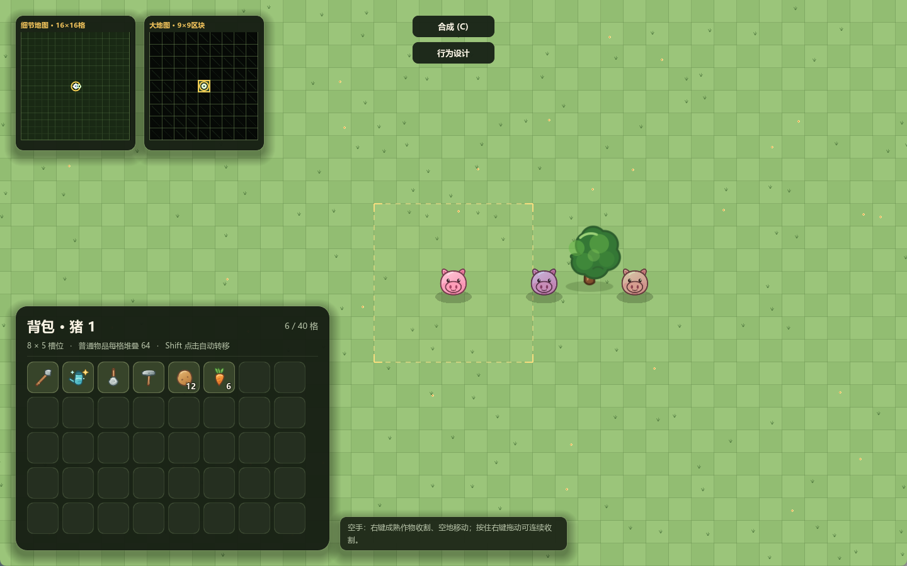

## 运行

用 Godot 4.7 打开本目录（`project.godot`），按 `F5` 运行；或命令行：

```powershell
godot --path .
```

基准视口 **1440 × 900**，初始 36 px 格子，短边 25 格。HUD 固定不缩放。

## 操作

| 操作 | 行为 |
| --- | --- |
| 左键点击猪 | 选中清醒的猪并打开它自己的背包 |
| 左键点击晕倒的猪 | 不选中，只提示用空手右键捡起 |
| 左键点击空地 | 取消选中；已下达的手动移动/动作继续执行 |
| 按住左键拖动空地 | 平移镜头；跟随猪时保留观察偏移 |
| 左键点击背包物品 | 当前猪手持该物品；再点一次或点空槽回到空手 |
| 左键点击箱子物品 | 选中箱子内的格子；取出物品请拖动到背包 |
| 左键拖动背包/箱子物品 | 整理、交换、合并，或在背包与箱子之间转移 |
| 点击小地图里的猪 | 直接选中该猪 |
| 点击小地图空白 | 打开对应层次全屏地图 |
| 全屏细节/大地图右键 | 命令当前选中猪前往该格/区块中心 |
| Shift + 点击背包/箱子/猪窝物品 | 自动转移到另一容器的可用槽位 |
| Shift + 点击合成配方 | 一次合成一组（最多 64 个产物） |
| 点击左上「细节地图」 | 打开当前细节层全屏地图 |
| 点击左上「大地图」 | 打开带迷雾的全屏大地图 |
| 大地图内左键点击已探索区块 | 镜头移动到该区块中心（不传送猪）；未探索区块不可前往 |
| 右键，空手，成熟作物 | 收割 2–3 个产物 |
| 右键，空手，其他地面 | 命令猪寻路走到目标格子 |
| 右键，空手，晕倒的猪 | 把猪捡进背包，猪的背包内容保留 |
| 右键，手持锤子，清醒的猪 | 把猪敲晕，播放打击音效和星星特效 |
| 右键，手持锤子，3×3 大树 | 敲击一次；累计 3–5 下后伐倒 |
| 右键，手持锤子，木头/木板/栅栏 | 拆掉并收回对应物品 |
| 右键，手持锤子，石方块/石砖方块/熔炉 | 拆掉并收回对应物品；熔炉需先清空 |
| 右键，手持锤子，石头/石头矿脉 | 普通石头 6–10 下掉 16–30 石头；石头矿脉按矿脉规则产出 |
| 右键，手持锤子，空箱子/空猪窝 | 拆掉并收回箱子/猪窝；非空时会拒绝 |
| 右键，手持锄头 | 把普通草地锄成耕地 |
| 右键，手持铲子 | 把没有作物的耕地铲平 |
| 右键，手持土豆 / 胡萝卜，空耕地 | 消耗 1 个种子并种下 |
| 右键，手持超级水壶，作物 / 树苗 | 推进一个生长阶段 |
| 右键，手持木头 / 木板，空草地 | 放置一格木头 / 木板 |
| 右键，手持石头 / 石砖，空草地 | 放置占满一整格的石方块 / 石砖方块 |
| 右键，手持熔炉，空草地 | 放下熔炉 |
| 右键，已放置的熔炉 | 打开熔炉面板：矿石输入 + 燃料 + 产物 |
| 右键，手持树苗，平地 | 种下树苗，约 90 秒长成 3×3 大树 |
| 右键，手持箱子，平地 | 放下一个 40 格箱子 |
| 右键，已放置的箱子 | 打开箱子面板；箱子和背包可以互相拖动 |
| 右键，手持木栅栏，平地 | 放下木栅栏；只在有相邻方块的方向伸出连接杆 |
| 右键，手持猪窝，平地 | 放下 3×3 猪窝 |
| 右键，已放置的猪窝 | 打开猪窝面板（两个猪槽、食物槽、输出槽） |
| 右键，手持猪，平地 | 放下背包里的猪；它会醒来并保留原背包 |
| 顶部「合成 (C)」按钮 | 在右侧打开合成面板，与行为面板使用同一位置 |
| 顶部「行为设计」按钮 | 打开占满整个右侧的自动行为模块面板 |
| 右上角 FPS 监控 | 默认常驻显示 FPS 与毫秒；可在 Esc 菜单关闭 |
| 按住右键拖动 | 对经过的新格子连续执行同一操作 |
| 鼠标滚轮 | 缩放地图（HUD 固定不缩放） |
| `B` | 开关当前猪的背包 |
| `C` | 打开 / 关闭右侧合成面板 |
| `Esc` | 先关闭箱子/猪窝/熔炉/行为/合成/地图；没有这些面板时打开暂停菜单 |

## 暂停菜单与存档

按 `Esc` 打开暂停菜单：

- **继续游戏**：关闭菜单并恢复游戏。
- **保存游戏**：覆盖当前存档。
- **读取存档**：读取最近一次保存；没有存档时按钮禁用。
- **音效：开 / 关**：立即切换 `Master` 总线静音。
- **FPS 监控：开 / 关**：右上角 FPS/毫秒面板，默认开启，状态随存档保存。
- **世界种子**：显示当前 seed，可复制；输入框可填新 seed，点两次「新游戏」确认后清空当前存档并重开。
- 菜单打开时 `SceneTree.paused = true`，猪、作物和繁育都会暂停；菜单本身使用 `PROCESS_MODE_ALWAYS`，因此暂停中仍可保存/读取。

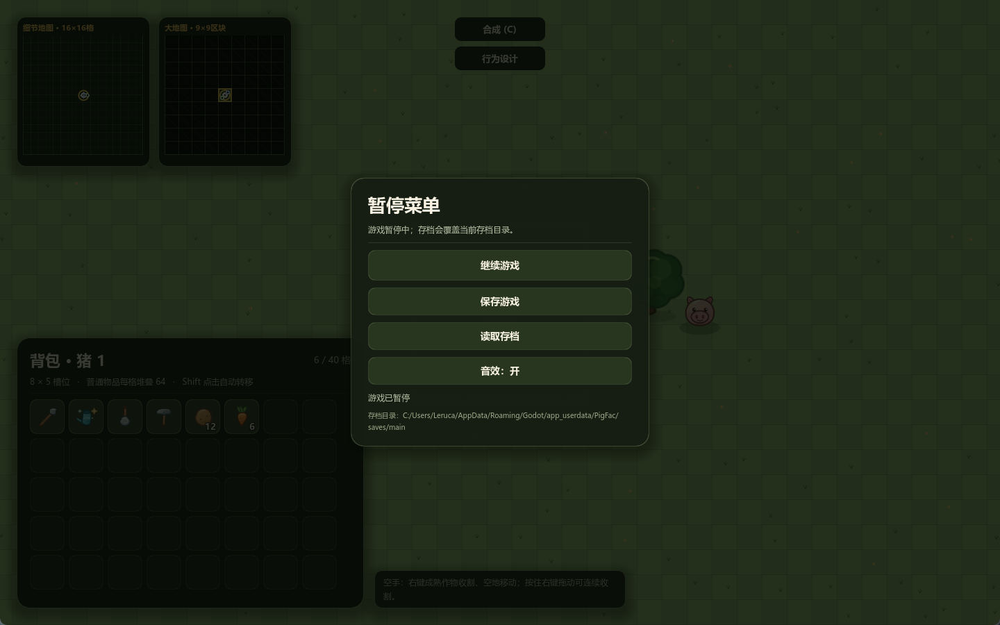

### 存档目录结构

存档是**一个文件夹**，当前只有一个存档槽：

```text
user://saves/main/
├── global.json          # seed、镜头、缩放、已探索区块、音效开关、猪列表
├── seed.txt             # 首次启动立即落盘的 seed，未正式保存时也能复现同一张地图
└── blocks/
    ├── 0_0.json         # 区块 (0,0) 的玩家改动差分（overrides）
    ├── 1_0.json
    └── -1_0.json
```

- **每个大地图区块一个 JSON 文件**，文件名是 `x_y` 的坐标写法。
- 自然生成的地形/树/矿**不整份写入存档**；区块文件只写玩家改动（挖矿、砍树、建造、农田等）。
- 猪是全局态，统一写进 `global.json`，不再按块重复记录；猪背包、嵌套猪背包、行为程序一起保存。
- 箱子、猪窝、栅栏、木头、木板、树苗、农田等按所在区块写差分；箱子/猪窝库存随对象写入。
- **全局信息单独写在 `global.json`**：seed 字符串、世界生成版本、镜头、缩放、已探索区块、音效和 `_next_born_pig_index`。
- 读取时先解析所有文件，确认可读后才清空当前世界并重建；写入使用 `.tmp` + rename。
- **v1 旧档会自动迁移**：旧块文件没有 `chunk` 字段时，按文件名/旧 `block` 推断区块，把旧顶层对象包装成 overrides；旧树按 `planted_trees` 保留，旧档使用 `legacy-v1` 固定种子。
- 读取后不会自动选中猪；镜头、缩放、地图探索和音效状态会恢复，猪需要重新点击选中。
- 当前没有自动存档、多存档槽或云存档；读取后猪的瞬时寻路路径和手持槽选择不恢复。


## 三只猪与手持物

- 初始地图有三只猪：粉色「猪 1」、淡紫色「猪 2」、薄荷色「猪 3」，各自独立 40 格背包。
- 猪身边会显示手持物徽标：工具/物品/方块图标，可堆叠物品显示数量。
- 切换手持槽、消耗、拖拽、存箱、捡猪或放猪后，徽标都会实时刷新。
- 猪本身占据当前格子；其他猪的 A* 寻路会把猪所在格视为障碍并绕开，手动走进猪格也会被拒绝。
- 选中圈已缩小到严格 **1×1 格子（36 px）**。
- 取消选中/切换猪不会取消**手动**移动和待执行动作，猪会继续完成；已经开启的自动行为也继续。

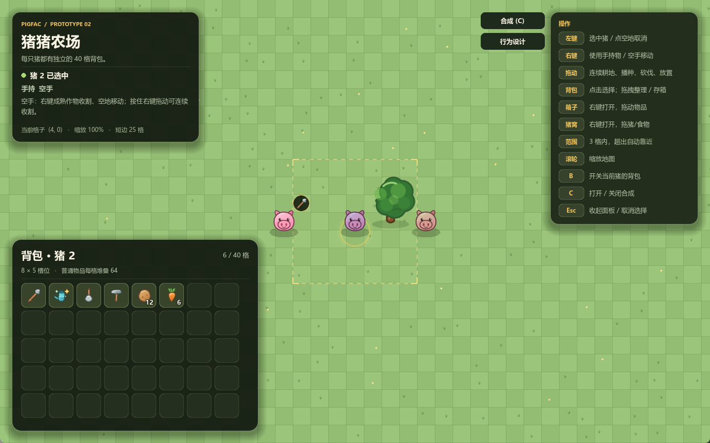

## 打晕、捡猪与放猪

- 手持锤子右键清醒的猪：猪被敲晕，停止移动，头顶出现旋转星星，并触发打击音效和星形粒子。
- 空手右键晕倒的猪：把猪装进当前猪的背包，占 1 个物品格；该猪原来的背包、RGB 和名字都会保留。
- 背包里的猪显示为「猪」物品，悬停提示会显示它的 **RGB** 和背包已用格数。
- 手持猪物品右键平地：把猪放到地面，猪会立即醒来，原背包内容仍在，可以正常选中和操作。
- 猪物品不能叠放，也不能放到已有猪、耕地、树、箱子、栅栏或猪窝的格子上。

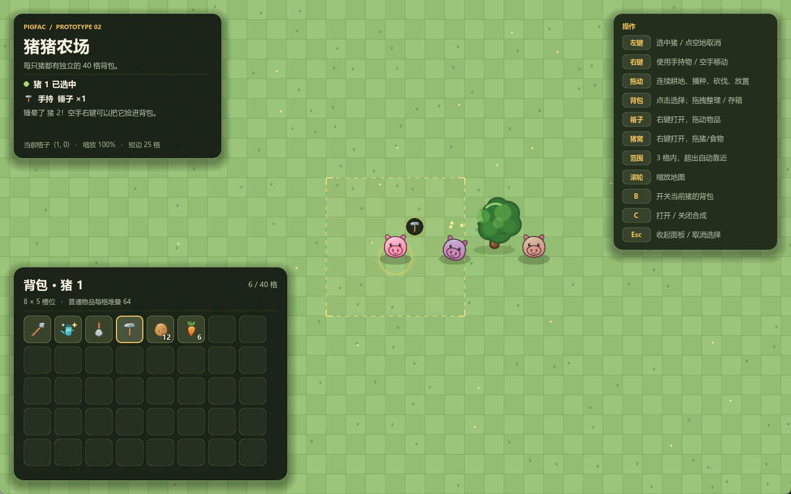

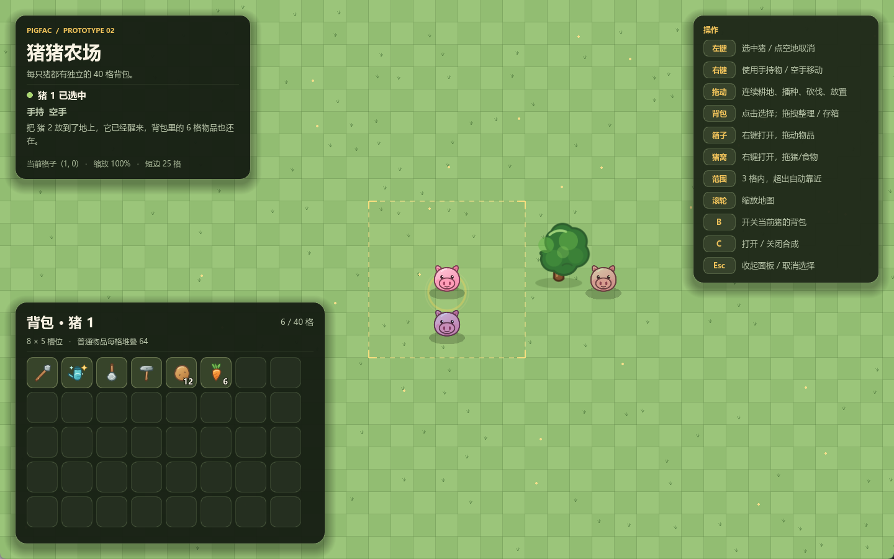

## 树木、树苗、木头与木板

- 场景中有一棵 **3×3** 的大树，占据九个格子并阻挡移动。
- 手持锤子右键大树：每敲一下都会播放砍树音效、在树冠处喷出小落叶，并提示剩余次数。
- 每棵树有随机 **3–5 下**耐久；伐倒后掉落 **木头 ×8–11、树苗 ×2–3**。
- 树苗可以种在普通平地（不能是耕地）；种下后每 **30 秒**生长一个阶段，**90 秒**长成新的 3×3 大树，超级水壶每次推进一个阶段。
- 木头和木板都能放在普通平地上，占据完整一格并阻挡移动；锤子可以拆回。木板方块使用程序化绘制的三块板，严格铺满 36×36 整格，没有透明边距。
- 树苗成熟时会检查周围 3×3，遇到树/木头/木板/箱子/栅栏/猪窝/耕地/猪会延后成长。

## 石头、煤矿、方块与熔炉

- **普通石头**：浅灰色 2×2 小山造型；锤击 **6–10 下**，总共产出 **16–30 个石头**，每下都会掉一部分。
- **石头矿脉**：和其他矿脉一样由 REGION 级随机游走生成，灰色矿堆；每条脉总矿量至少 **50,000**，用锤子逐单位采集。
- **煤矿脉**：铜/铁/金/石头之外的矿种，黑色矿堆；每条煤矿脉总矿量同样至少 **50,000**，采到的煤炭可在熔炉里燃烧 **40 秒**。
- **石头 / 石砖方块**：都是占满一整格、阻挡移动的可放置方块；锤子可拆回。
- **熔炉**：占满一格，右键打开面板：
  - 矿石输入槽：铜矿石 / 铁矿石 / 金矿石；
  - 燃料槽：木头（20s）、木板（10s）、煤炭（40s）；
  - 5 秒熔炼 1 个矿石 → 1 个对应锭；
  - 输出槽只出不进；清空后才能锤拆熔炉。

## 锤子与所有方块

- 锤子可以拆：
  - 3×3 大树（需要 3–5 下，掉木头和树苗）
  - 地上的木头、木板、木栅栏（各收回 1 个）
  - 普通石头（6–10 下，累计掉 16–30 石头）
  - 石方块 / 石砖方块（各收回 1 个）
  - 空熔炉（收回 1 个熔炉）
  - 空箱子（收回 1 个箱子）
  - 空猪窝（收回 1 个猪窝）
- 箱子/猪窝里还有物品时会拒绝拆除，先把内容物拖走即可。
- 每次非树木锤击都有独立的锤子打击音效；树木使用砍树音效并附带落叶。

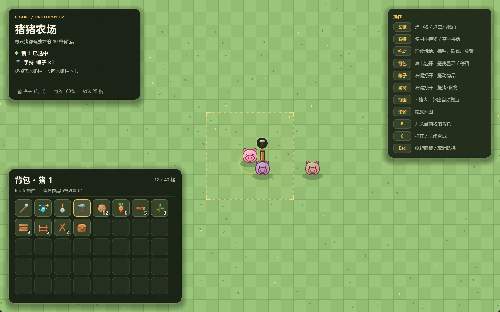

## 背包拖拽与箱子

- 背包固定 40 格（8×5），普通物品每格堆叠 64，工具/猪物品堆叠上限为 1。
- 拖动整堆物品：空槽移动、同类合并、异类交换；拖拽预览显示图标、名称和数量。
- 箱子由 **8 木板**合成，放在平地后占据一格并阻挡移动；每个箱子有独立 **40 格**库存。
- 右键箱子打开面板，箱子和猪的背包同时显示在左右两侧，可以双向拖动。
- 箱子打开时，按住 **Shift** 点击背包或箱子里的物品，会把这个整堆物品自动转移到另一边的可用栏位（先合并半堆，再使用空槽）。
- 猪窝也视为容器：打开猪窝时，Shift 点击背包里的猪/土豆/胡萝卜会进入亲代槽或食物槽；Shift 点击猪窝槽位会转回背包。
- 箱子与猪窝面板互斥；按 `Esc` 优先关闭最上层面板。

## 合成

按 `C` 或点顶部「合成」按钮，在**右侧**打开合成面板；它和行为设计面板使用同一块右侧区域，两者互斥。使用当前选中猪的背包作为材料来源；材料不足或产物放不下时不会净消耗材料。按住 **Shift** 点击配方会连续合成，直到产物达到一组（最多 64 个）或材料/空间不足。

| 产物 | 材料 |
| --- | --- |
| 木板 ×4 | 木头 ×1 |
| 木棍 ×4 | 木板 ×2 |
| 箱子 ×1 | 木板 ×8 |
| 木栅栏 ×1 | 木棍 ×2 + 木棍 ×4（共 6 木棍） |
| 猪窝 ×1 | 木头 ×4 + 木板 ×4 + 箱子 ×1 |
| 石砖 ×2 | 石头 ×4（即 2 石砖消耗 4 石头） |
| 熔炉 ×1 | 石砖 ×4 |

木栅栏配方按你给出的 **2 木棍 + 4 木棍** 实现，总消耗 6 木棍。如果本意是「2 木棍 + 4 木板」，只需修改 `scripts/crafting.gd` 里的 `RECIPES` 数据。

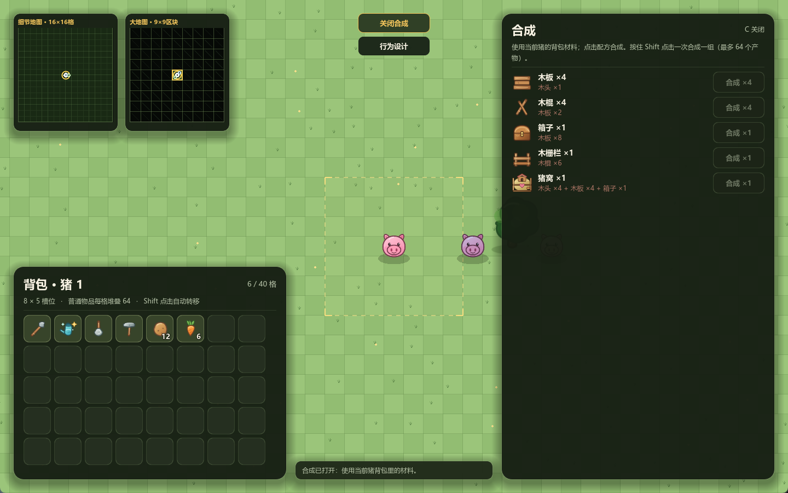

## 猪窝与 RGB 繁育

- 猪窝由 **4 木头 + 4 木板 + 1 箱子**合成，放下后占地 **3×3** 并阻挡移动。
- 放置时鼠标选中的格子是猪窝的**中心**，3×3 范围向四周展开。
- 右键猪窝打开面板：**两个亲代猪输入槽 + 一个食物输入槽 + 一个新生猪输出槽**。
- 两个亲代槽只接受猪物品；食物槽只接受土豆/胡萝卜；输出槽只能取出，不能放入。
- 食物数量 **≥ 10**、两个亲代槽都有猪、输出槽为空时开始工作，进度条走 **10 秒**。
- 完成后消耗 **10 食物**，在输出槽产出一只猪：
  - 猪的 RGB 分别取两只亲代的平均值，再各加少量随机偏移（±10，限制 0–255）。
  - 新生猪的背包为 **空** 的 40 格背包，可以拖出输出槽再放到地面。
- 亲代猪不会被消耗，食物足够且输出槽清空后会继续繁育。
- 猪物品的悬停提示和猪窝面板都会显示 RGB，方便观察遗传结果。

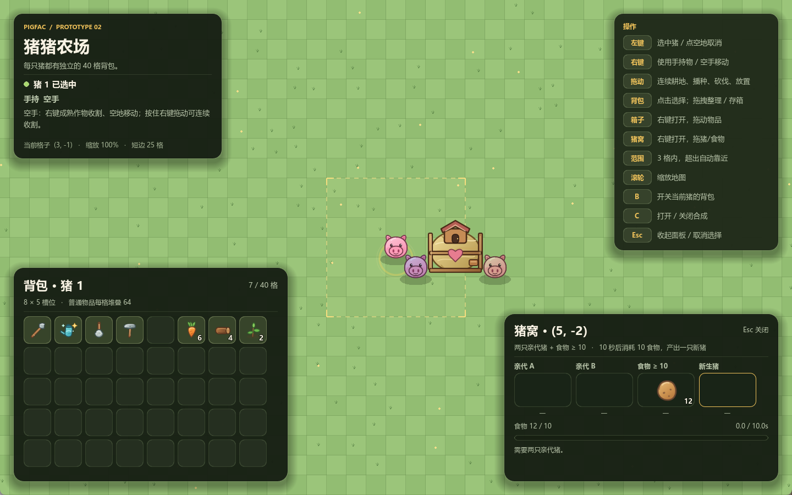

## 行为设计（自动化）

选中猪后，点屏幕顶部「行为设计」按钮，右侧会打开占满高度的行为面板。面板支持反复添加模块、拖动模块行重排、删除单个模块或一键清空。

四种模块：

1. **移动到指定格子**：点「选择位置」后，直接在世界上左键点一个格子。
2. **区域内使用工具**：点工具选择按钮，在图标窗口里选锄头、超级水壶、铲子、锤子、土豆种子、胡萝卜种子或空手；点「框选区域」后，在世界上按住左键拖出一个矩形。
3. **把物品存入容器**：用同一个图标窗口选择物品，再点「选择容器」并左键点一个箱子或猪窝。
4. **从容器拿取物品**：同样选择物品和容器。箱子是 40 格通用库存；猪窝按专用规则接收猪/食物、取出亲代或新生猪。

工具和物品现在共用同一个二维图标选择窗口：

- 工具行和物品行的选择按钮样式一致。
- 工具选择窗口中，背包里没有的工具半透明且不可点。
- 空手用**左上角的空格子**表示。
- 物品选择窗口显示全部物品图标，当前选择有高亮边框。

执行规则：

- 点「开始自动」后循环执行模块；实际互动（使用工具/存容器/取容器）上限为 **每 1 秒一次**。
- 自动模式会锁定该猪的手动世界操作；右键移动/使用工具都会被拒绝并提示，必须先暂停自动。
- 目标不在互动范围时，猪会用 A* 自动走到范围内再执行。
- 区域工具会先判断当前格子的条件：条件不成立就**立刻跳到下一格，不占 1 秒**；条件成立才执行并等待 1 秒。
- 区域工具在条件成立但需要移动时才会走向该格；不可达的格子会直接跳过。
- 一个区域处理完后进入下一个模块。
- 存容器/取容器每次移动一整堆，成功后等 1 秒再继续，直到没有可移动物品才进入下一模块。
- 行为面板会显示**当前选中猪**正在执行的步骤编号、模块类型和正在关注的格子，例如「步骤 #2：区域使用锄头 · 关注 (3, 4)」。
- **自动模式不再要求选中**：所有 `behavior_running` 的猪都会各自推进程序；取消选中后猪继续移动/使用工具/存箱，镜头和 HUD 只是不再跟随它。
- 每只猪有独立的行为进度、等待计时和移动路径，可以同时自动工作。
- 切换到别的猪不会重置自动猪的进度；只有编辑模块/选择区域/更换工具时，才会重置当前选中猪的执行位置。
- 当前选中的自动猪在配置区域/位置/容器时暂停自己，其他自动猪继续。
- 关闭行为面板**不会停止**正在运行的程序；需要停止时重新选中该猪，打开面板点「暂停自动」，或清空模块。
- 猪被捡起/放进背包时不会带走行为程序；本轮以背包和 RGB 保留为主。

一个可用的自动种田流程示例：

1. 区域使用锄头 → 锄一片地
2. 区域使用土豆种子 → 播种
3. 区域使用超级水壶 → 催熟（循环会继续浇水）
4. 区域使用空手/收割 → 收成熟作物
5. 把“土豆”存入箱子 → 自动存仓

因为模块会循环，区域里的无效格子会被快速跳过；例如收割模块在作物未成熟时不会拖慢整片区域，水壶模块也会快速跳过已成熟作物。3 次浇水后即可成熟收割并存入箱子。

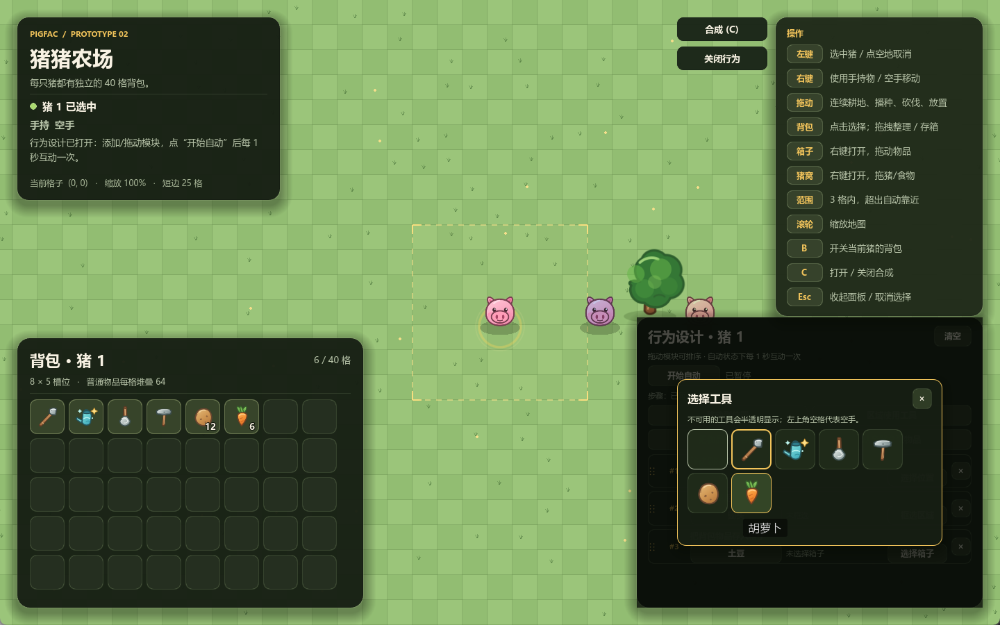

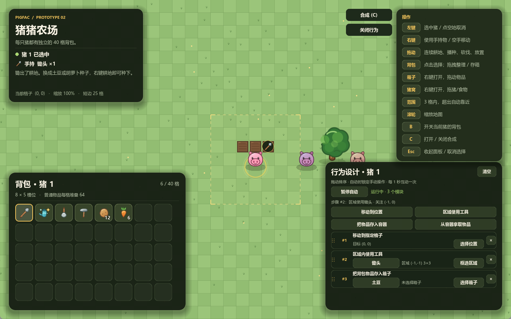

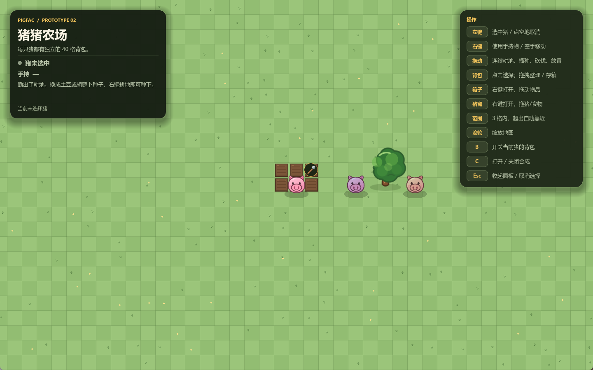

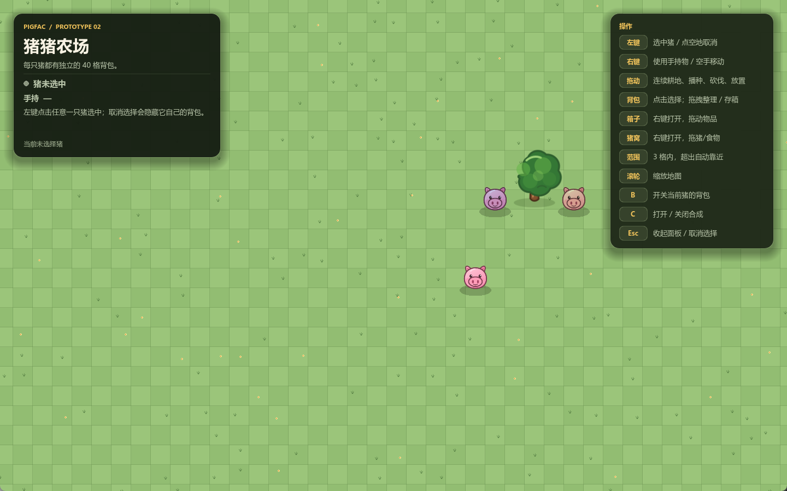

## 木栅栏的道路式连接

- 木栅栏放在平地上，占满一整格并阻挡移动。
- 单独放一个栅栏时只有一根中心木桩，不会凭空出现横杆。
- 只有相邻方向存在栅栏、箱子、木头、木板、大树或猪窝时，才从中心向那个方向伸出两根连接杆。
- 四个方向各自独立判断，效果类似道路连接：有邻居的方向有杆，没有邻居的方向保持空。
- 连续摆放时，相邻格子的连接杆在格边对接，形成真实连贯的栅栏。

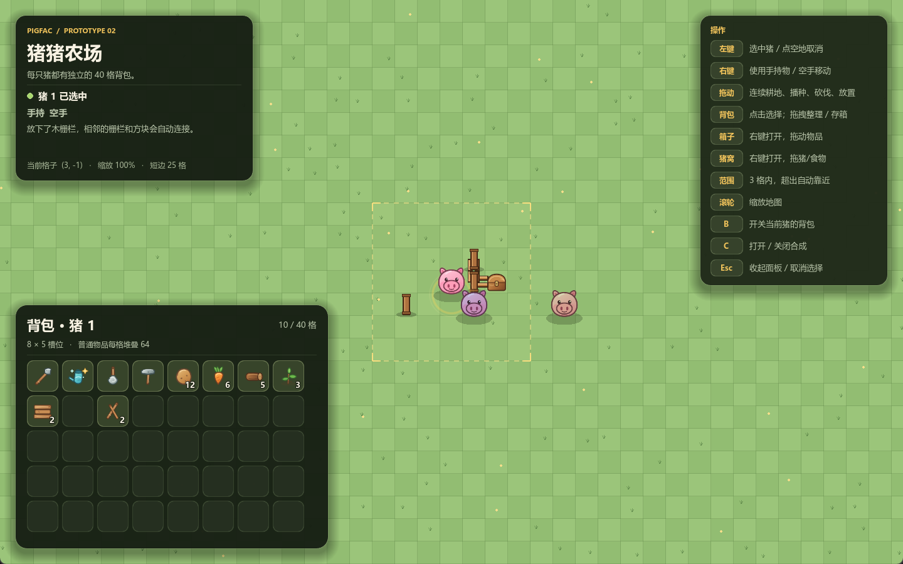

## 音效

- 砍树：`chop.wav`；锤子拆方块/敲击：`hammer.wav`。
- 锄地：`till.wav`；种植：`plant.wav`；浇水/催熟：`water.wav`。
- 猪每抖动一次播放一次 `step.wav`（每 0.24 秒左右）。
- 锤晕猪：`stun.wav`，并伴随 `StunBurst` 星形粒子和头顶旋转星星。
- 本轮把脚步、锄地、种植、浇水音量整体调低（脚步 -20 dB，锄地 -14 dB，种植 -15 dB，浇水 -16 dB）。

音效距离/缩放衰减：

- 以**当前镜头中心**为听点，按世界格距离衰减：`距离系数 = clamp(1 - 距离格数 / 50, 0, 1)`。
- 再乘缩放系数：`clamp(相机 zoom, 0, 1)`；缩放越小整体越小声，放大不会额外增益。
- 两个系数相乘后转成 dB，叠加到每个音效的基准音量。
- **50 格时衰减到 0**（-80 dB，实际静音），屏幕中心附近保持基准音量。
- 脚步、砍树、锤子、锄地、种植、浇水、敲晕猪全部应用该规则；镜头拖动后听点也会跟着移动。

## 自动靠近

农耕、收割、敲树、拆方块、种树苗、放箱子/栅栏/猪窝、打晕猪、捡猪和打开箱子/猪窝，都使用以猪当前格子为中心的**切比雪夫距离 3**（7×7 范围）。

- 目标在范围外时，猪会先用 **A\*** 寻路到范围内可站立的空格，到达后自动执行原操作。
- 寻路使用直走 1、斜走 √2 的八方向代价；其他猪所在的格子也会阻挡寻路。
- 树、树苗、木头、木板、箱子、栅栏、猪窝会阻挡寻路；互动范围本身只按格子距离计算，不受障碍物影响。
- 右键远处的箱子/猪窝时，猪会先走到互动范围内再打开。
- 无路可走时会提示，不会强行执行。

## 寻路稳定性

- A* 的 open 集改为二叉堆，不再用线性扫描。
- 单次寻路最多展开 **12000** 个节点，目标距离超过 **100 格**时直接拒绝。
- 目标被围死或不可达时会快速返回，不再长时间卡住主线程；拖动/自动行为也会收到“无法到达”的结果。
- 其他猪的格子仍然作为寻路障碍。

## 农耕循环

1. 选中猪，用手持锄头右键或拖过草地 → 耕地。
2. 手持土豆/胡萝卜，右键或拖过空耕地 → 播种。
3. 每 **30 秒**生长一个阶段，**90 秒**成熟。
4. 超级水壶可以推进一个阶段。
5. 空手右键/拖过成熟作物 → 收割 2–3 个产物，耕地保留。
6. 铲子可以把空耕地恢复为普通草地。

作物上方三颗阶段点会依次点亮。成熟时出现金色闪光：土豆开花并露出块茎，胡萝卜露出橙色根肩。

## 地图缩放

鼠标滚轮缩放 `Camera2D.zoom`，范围 65%–180%，HUD 尺寸保持不变；缩放同时影响音效衰减。

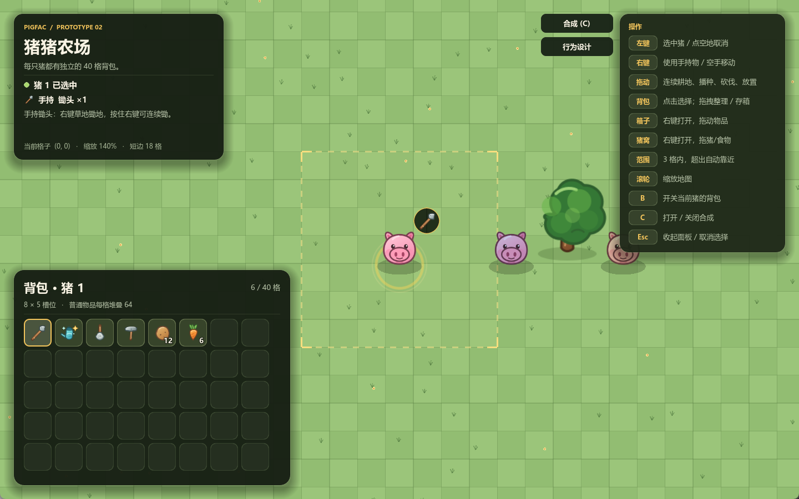

## 地图分层与小地图

地图分两层：

- **细节层**：当前农场，1 格 = 1 m。
- **大地图层**：1 个大地图格对应细节层的 **±127 格**，即 255×255 m。块坐标 `B(0,0)` 的中心是细节坐标 `(0,0)`；`B(1,0)` 的中心是 `(255,0)`。
- 左上角有两个小地图窗口：
  - 「细节地图」固定显示当前细节块，使用 **16×16 个展示格**，每格代表 16×16 个世界格；颜色取该块内**占比最大**的地形/水域/农田/障碍；只要块内有矿格，就按该块主导矿种显示铜/铁/金色。
  - 「大地图」显示 9×9 个大区块；已探索区块为亮色，未探索为迷雾。
- 两个小地图里都用点显示三只猪的位置；当前选中猪有黄色圈。
- 点击小地图里的猪可以直接选中；点击空白处打开对应层次的全屏地图。
- 全屏细节地图固定为 **512×512**，一次显示当前细节块的全部 16×16 格，不再跟随镜头移动。
- 全屏大地图左键可前往**已探索**区块中心：只移动镜头，不传送猪；未探索的迷雾区块不能直接跳转。
- 迷雾区块需要猪走过去、或镜头实际移动到该区域才会揭开；右键仍可命令猪前往任意区块中心。

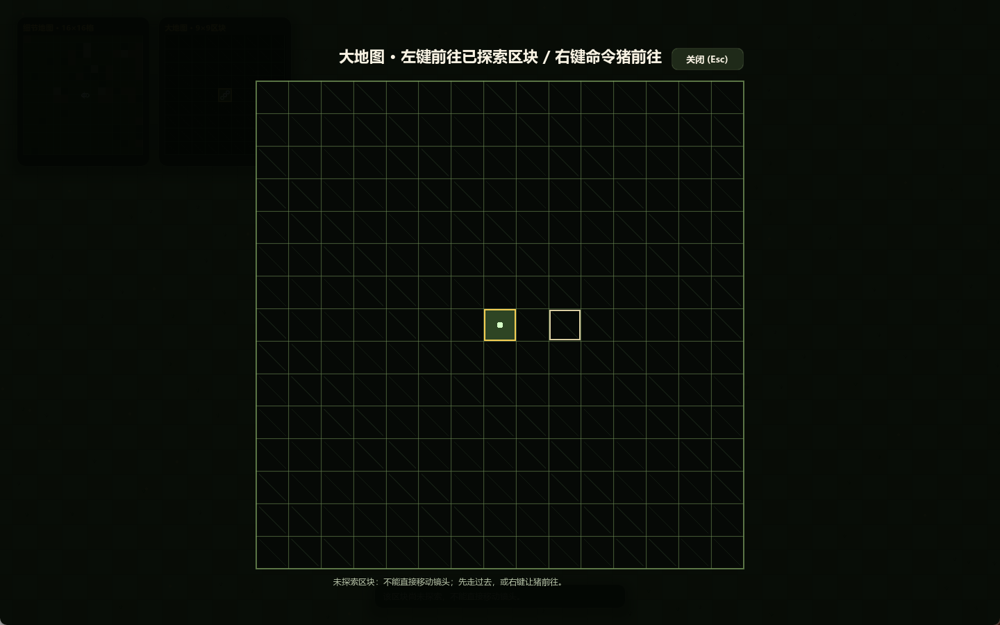
- **右键全屏细节地图或大地图**：命令当前选中猪前往该细节格或区块中心；不会传送，猪会寻路过去。
- 地图导航不会把猪随镜头传送；`teleport_active_pig_to_block()` 逻辑保留但当前不调用。
- 镜头和猪经过的区块会自动标记为已探索；大地图只会揭开实际去过/进入过的区块。
- 细节层切到大地图区块时，如果当前猪正在自动执行，会保留行为程序并继续在新位置执行。


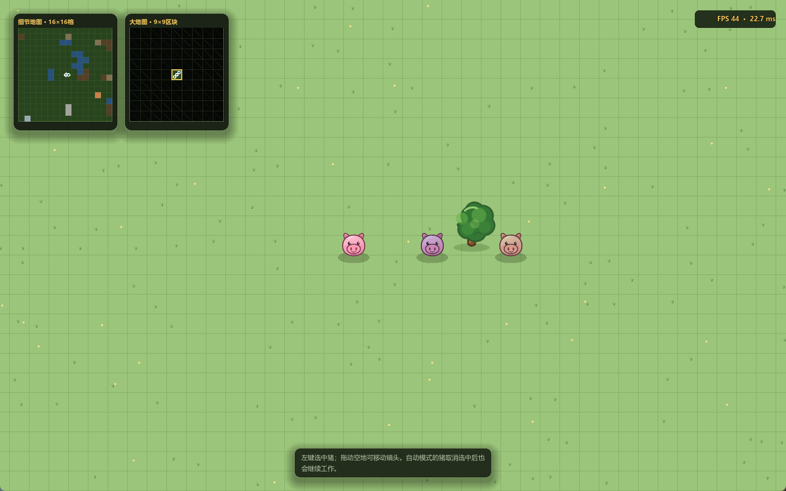

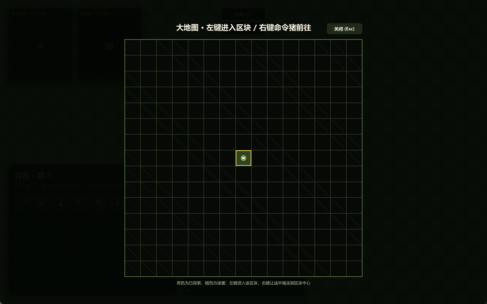

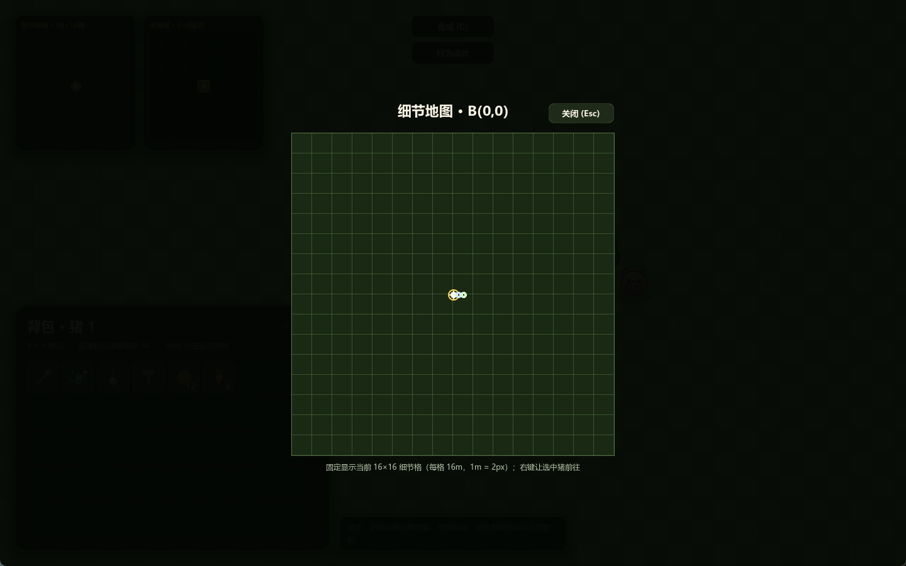

## HUD 布局

- 左上角状态栏和右上角操作说明已隐藏。
- 左上角改为两个小地图窗口：细节小地图 + 大地图。
- 顶部中央保留「合成 (C)」和「行为设计」两个按钮。
- 合成和行为设计都占满**整个右侧**（从顶部到底部），共用同一块区域且互斥。
- 背包固定在左下角；箱子/猪窝仍在右下角，行为/合成面板打开时会先关闭它们。
- 底部中央新增一个轻量提示条，继续显示操作反馈。
- 全屏地图会覆盖 HUD，按 `Esc`、关闭按钮或点击地图外区域关闭。
- `Esc` 暂停菜单会覆盖 HUD；菜单打开时游戏暂停，音效开关和存档操作仍可用。

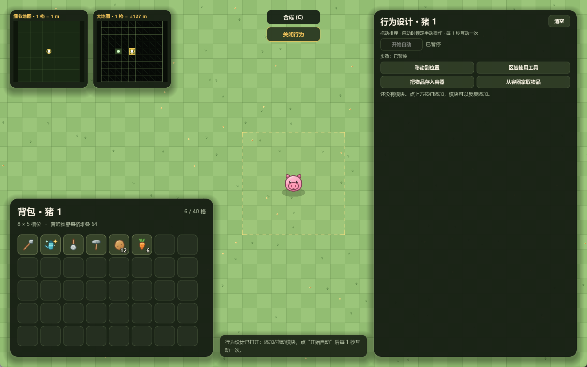

## 格子地图

- 格子尺寸 **36 px**；默认 1440×900 下约为 **40×25 格**。
- `WorldGrid` 只绘制摄像机可见范围，没有固定地图边界，负坐标可用。
- 猪、作物、箱子、猪窝都以 `Vector2i` 格子坐标为键；猪的当前位置也是寻路障碍。
- 摄像机跟随当前选中的猪；地图导航只改变观察位置，不会传送猪。

## 随机世界与矿脉

- 世界由 **64 位 seed** 驱动，同 seed + 同生成器版本 + 同区块坐标生成相同内容；区块按 **255×255 格**（与存档块一致）生成。
- 镜头周围 **5×5 个区块**会预生成；当前镜头所在块同步生成，避免跨块时整屏空白，周围区块继续分帧预生成。
- 为避免 25 个 255×255 区块的树/矿全部进入绘制，真正物化到场景的只有中心 **3×3** 区块，其余 5×5 只保留生成数据；视野仍然在中心块内。
- 地表分为草地、裸土、沙地、水域等；树/石头/灌木会阻挡寻路，水域也会阻挡。
- 出生半径 **24 格**内保证草地、无障碍、无矿；初始猪和教学树的位置不会被随机物覆盖。
- 矿脉按 REGION 级随机游走生成，跨区块连续；当前矿种为**铜、铁、金、煤、石头**，越远离出生点越容易出铁矿/金矿。
- 每条矿脉总矿量至少 **50,000**（当前区间 50,000–80,000），按脉内格子均分；矿石用锤子敲：每下采 1 单位并获得 **1 个对应物品**；背包满时不会消耗矿点。
- 已采矿、砍树、建造、农田等作为差分写入区块；自然地形/树/矿不整份落盘，读档时由 seed 重生成。
- Esc 菜单可查看/复制 seed，也可输入 seed 并确认新游戏。
- 详细设计、确定性约束和生成 API 见 [docs/worldgen.md](docs/worldgen.md)。

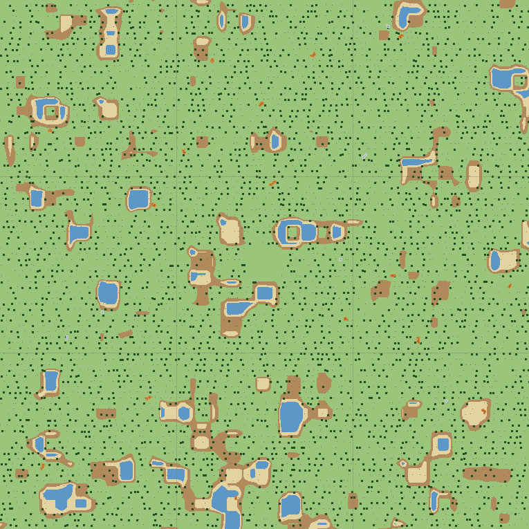

## 项目结构

```
assets/
  pig.svg
  potato.svg / carrot.svg
  hoe.svg / watering_can.svg / shovel.svg / hammer.svg
  wood.svg / tree.svg / sapling.svg / log.svg
  planks.svg / stick.svg / chest.svg / fence.svg
  copper_ore.svg / iron_ore.svg / gold_ore.svg
  pig_nest.svg / star.svg / leaf.svg
  audio/chop.wav / hammer.wav / till.wav / plant.wav
  audio/water.wav / step.wav / stun.wav
scenes/
  main.tscn           主场景（格子、农田、树/树苗/木头/木板/箱子/栅栏、
                      猪窝、三只猪、相机、HUD、双小地图、箱子/猪窝/合成/行为 UI、
                      区域框选、落叶/星形粒子与音效）
  pig.tscn            可复用的猪场景
scripts/
  main.gd             输入、猪交互、打晕/捡猪/放猪、A*、互动范围、
                      行为执行器、树木耐久、方块拆除、箱子/猪窝、音效、菜单/存档接线
  save_manager.gd     按大地图区块拆分保存/读取 global.json 与 blocks/*.json
  esc_menu.gd         Esc 暂停菜单（继续/保存/读取/音效/种子/新游戏）
  worldgen/           种子、地形、障碍、矿脉、区块缓存、差分存档、迁移
  world_grid.gd       无限格子绘制与坐标换算
  farm.gd             耕地、作物阶段、铲平、催熟与收割
  world_objects.gd    树/树苗/木头/木板/箱子/栅栏/猪窝与繁育逻辑
  interaction_range.gd  7×7 互动范围框
  pig.gd              猪的移动、脚步音效、手持物徽标、眩晕、独立背包
  inventory.gd        40 格背包、堆叠、容量、拖拽、猪物品 metadata
  inventory_slot.gd   单格拖拽数据、拖拽预览与放下处理
  inventory_ui.gd     40 格物品面板（背包和箱子共用）
  crafting.gd         合成配方与事务式消耗/产出
  crafting_ui.gd      合成面板与配方按钮
  nest_ui.gd          猪窝 3 输入 + 1 输出面板
  behavior_ui.gd      右侧行为设计面板（添加/拖动/参数）
  behavior_module_row.gd  行为模块行拖动数据
  behavior_area_overlay.gd 区域框选预览
  minimap.gd          左上角细节/大地图小地图
  map_overlay.gd      全屏细节/大地图与区块选择
  leaf_burst.gd       砍树落叶粒子
  stun_burst.gd       锤晕猪星形粒子
  item_db.gd          物品、工具、作物、建材、猪和猪窝定义
  hud.gd              状态、手持物、提示、坐标、面板与暂停菜单管理
  move_marker.gd      右键落点标记
  ui_style.gd         共享 UI 颜色、字体与样式
tests/
  test_inventory.tscn / test_inventory.gd
  test_farm.tscn / test_farm.gd
  test_runtime.tscn / test_runtime.gd
docs/
  .gdignore
  screenshot.png
  behavior.png
  behavior_running.png
  behavior_full.png
  auto_offselect.png
  camera_pan.png
  big_map.png
  detail_map.png
  pig_stun.png
  pig_place.png
  pig_nest.png
  crafting.png
  esc_menu.png
  worldgen-map.png
  fence.png
  hammer_blocks.png
  map_zoom.png
  pig2_backpack.png
```

## 性能

- 常态帧率上限 **120 FPS**（`Engine.max_fps = 120`），关闭 VSync；当前显示器为 **2560×1440 @165Hz**，无法物理显示 240 FPS。
- 地形 `WorldGrid` 和 `WorldObjects` 只在**镜头 transform 变化**或对象变更时重绘；静止时不会每帧重新遍历世界。
- `WorldObjects` 用 32×32 空间索引只提交可视区域对象；整格方块与矿点分别用 **MultiMesh** 批量提交（各 1 次 draw call），小地图地形 4×4 采样，矿石按块预聚合，不再为每个 16m 格扫描全部矿。
- 实时 FPS 监控默认开启，Esc 可关；开关随存档保存。监控使用帧 delta 自行平滑，不依赖可能被后台节流影响的 `Engine.get_frames_per_second()`。
- 当前机器压力测试：约 1,700 方块 + 1,900 矿点**边移动边重绘**约 **110–154 FPS**；约 9,500 方块 + 10,200 矿点 + 12,300 自然物静态约 130–154 FPS。正常游戏锁 120 FPS；显示器 165Hz，240 需要 240Hz 输出链路。

## 测试

本轮 `bash tests/run_worldgen_tests.sh --with-baseline` 通过 **24/24**：种子/坐标/边界、81k 断言跨块归属、地形单真源、矿脉连续性与分布、存档差分/卸载/迁移、黄金哈希、跨语言对拍、性能基准，以及既有 runtime/farm/inventory 和新增 features 基线。测试使用独立存档目录（`PIGFAC_TEST_SAVE_ROOT` 与 `SavePaths.set_root`），不会改动玩家 `user://saves/main`。

下方命令保留给后续回归：

```powershell
godot --headless --path . res://tests/test_inventory.tscn
godot --headless --path . res://tests/test_farm.tscn
godot --headless --path . res://tests/test_runtime.tscn
godot --headless --path . res://tests/test_features.tscn
godot --headless --path . --quit-after 5
```

`test_inventory` 覆盖：40 格、64 堆叠、移除、跨背包移动、同类合并、异类交换、猪物品 metadata 保留，以及木板/木棍/箱子/木栅栏/猪窝的完整合成链。

`test_runtime` 覆盖上一轮已有系统：三只猪、独立背包、手持物徽标、猪占格阻挡 A*、猪物品捡起/放回并保留背包、3–5 下树耐久、树苗生长、箱子 40 格与独立库存、栅栏/木板占位、猪窝 3×3 与 4 槽、10 食物/10 秒产猪、RGB 遗传范围、锤子拆除全部方块、Esc 面板顺序、全部音效资源、地图缩放。**行为设计模块与 A* 堆优化尚未加入自动化测试。**

`test_features` 覆盖新增内容：普通石头 6–10 下产出 16–30 石头、石/石砖方块占格、熔炉冶炼铜锭、石砖与熔炉配方。

当前实现说明：

- 所有 `behavior_running` 的猪都会独立执行，不要求选中；选中只影响 HUD、背包、镜头跟随和行为编辑。
- 自动模式下该猪的手动右键操作会被锁定；关闭行为面板也不会自动停止，需要重新选中后打开面板暂停。
- 存容器/取容器模块现在支持箱子和猪窝；猪窝会自动把猪放进亲代槽、把土豆/胡萝卜放进食物槽，取出时优先新生猪输出槽。
- Shift 自动转移支持**箱子 ↔ 背包**和**猪窝 ↔ 背包**。
- 大地图点击区块只移动镜头，不会传送当前猪；传送函数保留但当前不调用。区块按 255×255 细节格划分，中心为 `block * 255`。
- 已探索区块为亮色，未探索为迷雾；只有实际走过/镜头到达才会揭开，不能靠大地图左键跳进迷雾。区块探索状态写入 `global.json`。
- 区域框选使用当前 36 px 格子；区域内的格子按行优先逐个判定条件，只有条件成立并执行时才占用 1 秒互动，无效格子会立即跳过。
- A* 单次最多展开 12000 个节点，目标距离超过 100 格会直接失败，避免不可达目标卡死。
- 箱子和猪窝有物品时不能锤拆；先清空/拖走内容物。
- 猪与猪之间通过格子占用互相阻挡，但没有物理推挤；正常情况下不会重叠。
- 工具没有耐久度；土豆/胡萝卜同时充当种子和食物。
- 存档会保存猪/猪窝/箱子/栅栏/树/木头/木板/耕地/作物的位置与进度，以及猪的背包、行为程序和猪窝繁育进度；瞬时寻路路径、手持槽选择和当前选中猪不保存。
- 当前只有一个存档槽，没有自动存档或云存档；v1 旧档会在读取时一次性迁移为 v2。
- 木头、木板、箱子、栅栏、猪窝和树苗只能放在普通空草地上，不能放在耕地或猪脚下。
